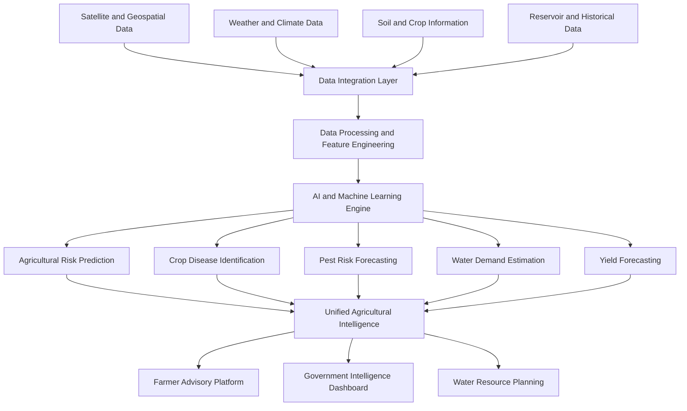

# AgriShield AI
### AI-Powered Agricultural Intelligence and Water Security Network

**Predict Agricultural Risks. Protect Water Resources. Empower Farmers.**

AgriShield AI is an AI-powered agricultural intelligence platform designed to help farmers and government authorities anticipate agricultural risks, optimize water resource management, and make informed decisions before crop damage becomes severe.

By integrating satellite imagery, weather forecasts, soil conditions, crop-growth stages, reservoir information, pest alerts, and historical agricultural data, AgriShield AI aims to transform fragmented agricultural information into actionable intelligence.

---

## 1. Problem Statement

Agriculture faces increasing uncertainty due to unpredictable weather patterns, climate change, crop diseases, pest outbreaks, and water scarcity.

Farmers often lack access to timely, location-specific information that could help them prevent crop damage. At the same time, agricultural authorities face challenges in monitoring regional agricultural conditions, assessing water availability, and identifying vulnerable areas.

Existing agricultural solutions frequently address these challenges independently, creating gaps in agricultural risk assessment and resource planning.

There is a need for an integrated intelligence platform that connects agricultural monitoring, predictive analytics, and water resource management.

## 2. Proposed Solution

AgriShield AI introduces a unified agricultural intelligence network that combines artificial intelligence, machine learning, geospatial analytics, and environmental data to identify potential agricultural risks and support preventive decision-making.

The platform analyzes multiple data sources to generate:

- Agricultural risk predictions.
- Crop disease identification.
- Pest outbreak risk assessments.
- Agricultural water demand estimations.
- Water availability insights.
- Smart irrigation recommendations.
- District-level agricultural vulnerability assessments.
- Yield forecasts and support prioritization.

The objective is to move agricultural management from reactive damage control toward predictive risk prevention.

## 3. Core Features

### 3.1 Agricultural Risk Prediction

- Analyze weather conditions, soil characteristics, crop-growth stages, and historical agricultural information.
- Identify potential agricultural risk conditions.
- Generate location-specific risk assessments.
- Support early identification of vulnerable agricultural regions.

### 3.2 Crop Disease Identification

- Analyze uploaded crop leaf images using computer vision.
- Identify potential crop diseases through image classification.
- Provide disease-related information and preventive recommendations.
- Support early crop health assessment.

### 3.3 Pest Outbreak Risk Forecasting

- Analyze environmental conditions and available historical pest information.
- Estimate potential pest outbreak risks.
- Identify regions requiring closer agricultural monitoring.
- Support preventive agricultural interventions.

### 3.4 Agricultural Water Intelligence

- Estimate crop-specific water requirements.
- Analyze weather conditions and crop-growth stages.
- Integrate reservoir and available water resource information.
- Identify potential water stress conditions.
- Support informed agricultural water management.

### 3.5 Smart Irrigation Planning

- Generate irrigation recommendations using crop water requirements.
- Consider weather conditions and estimated water availability.
- Support efficient irrigation planning.
- Promote responsible water resource utilization.

### 3.6 Water-Sharing Scenario Simulation

- Explore hypothetical water allocation scenarios.
- Compare estimated agricultural water demand with available resources.
- Evaluate alternative water distribution scenarios.
- Support planning by agricultural and water resource authorities.

### 3.7 Government Intelligence Dashboard

- Visualize district-wise agricultural risk conditions.
- Monitor water availability and estimated agricultural demand.
- Identify potentially vulnerable agricultural regions.
- Support data-driven resource allocation.
- Prioritize regions requiring agricultural intervention.

### 3.8 Yield Forecasting

- Analyze historical crop yields and environmental variables.
- Estimate potential agricultural productivity.
- Identify factors associated with yield variation.
- Support agricultural planning and decision-making.

### 3.9 Multilingual Farmer Advisories

- Provide agricultural information in Tamil and English.
- Generate localized risk notifications.
- Deliver understandable preventive recommendations.
- Improve accessibility of agricultural intelligence.

---

## 4. System Architecture

AgriShield AI follows a modular architecture that connects agricultural data collection, processing, predictive intelligence, and decision-support interfaces.



### Processing Workflow

1. Data Collection: Collect relevant satellite, weather, soil, crop, reservoir, and historical agricultural information.
2. Data Integration: Combine information from different sources into a unified data-processing pipeline.
3. Data Processing: Clean, validate, and transform collected information into machine learning features.
4. Predictive Analysis: Apply machine learning and computer vision models to identify agricultural risks.
5. Intelligence Generation: Combine model outputs into understandable agricultural assessments.
6. Recommendation Generation: Produce relevant advisories and water management recommendations.
7. Decision Support: Present actionable insights through farmer and government interfaces.

---

## 5. What Makes AgriShield AI Different?

Traditional agricultural applications often focus on individual problems such as crop disease identification, weather forecasting, or irrigation recommendations.

AgriShield AI aims to connect these individual capabilities through a unified agricultural intelligence framework.

| Traditional Agricultural Solutions | AgriShield AI |
|---|---|
| Individual crop monitoring | Integrated agricultural intelligence |
| Reactive disease identification | Predictive crop risk assessment |
| Isolated weather information | Combined environmental risk analysis |
| Basic irrigation recommendations | Water demand and availability intelligence |
| Limited geographic visibility | District-level agricultural intelligence |
| Individual farmer-focused systems | Farmer and government decision support |

### Key Innovation: Connected Agricultural Risk and Water Intelligence

The central innovation of AgriShield AI is its ability to connect agricultural risks with water resource conditions.

For example, a district experiencing below-normal rainfall, declining reservoir levels, increasing temperatures, and high crop water requirements may face emerging agricultural vulnerability.

AgriShield AI aims to analyze these interconnected indicators to identify potential risks and provide early decision-support recommendations.

This approach connects agricultural productivity with sustainable water resource management.

---

## 6. Technology Stack

| Component | Technology | Purpose |
|---|---|---|
| Frontend | React.js | Interactive user interfaces |
| Backend | Python, FastAPI | REST APIs and application services |
| Machine Learning | Scikit-learn, XGBoost | Agricultural risk prediction and forecasting |
| Computer Vision | Image Classification Models | Crop disease identification |
| Geospatial Intelligence | Google Earth Engine, Sentinel | Satellite imagery and geographic analysis |
| Database | PostgreSQL, PostGIS | Agricultural and spatial data management |
| Notifications | Firebase | Alerts and notifications |

### Technical Architecture

- Modular backend architecture.
- API-based frontend and backend communication.
- Independent machine learning components.
- Geospatial database support.
- Expandable agricultural data integration.
- Separate interfaces for farmers and government authorities.

---

## 7. Target Users

### Farmers

- Access localized agricultural risk information.
- Identify potential crop health issues.
- Understand crop water requirements.
- Receive preventive agricultural advisories.
- Access information in Tamil and English.

### Agricultural Authorities

- Monitor agricultural conditions across districts.
- Identify potentially vulnerable regions.
- Analyze estimated water demand and availability.
- Prioritize agricultural support and interventions.
- Explore alternative water allocation scenarios.

### Water Resource Management Authorities

- Monitor agricultural water requirements.
- Analyze regional water availability.
- Evaluate hypothetical water-sharing scenarios.
- Support sustainable water resource planning.

---

## 8. Expected Impact

AgriShield AI is designed to contribute to:

- Early identification of agricultural risks.
- Improved agricultural decision-making.
- More informed irrigation planning.
- Better visibility into regional water stress.
- Improved accessibility of agricultural advisories.
- Data-driven prioritization of vulnerable regions.
- More sustainable agricultural water management.

The platform aims to support farmers and authorities with actionable information before agricultural risks become severe.

---

## 9. Development Roadmap

### Phase 1: Platform Foundation
- [ ] React frontend development.
- [ ] FastAPI backend development.
- [ ] Database integration.
- [ ] Core application architecture.
- [ ] Farmer and government interfaces.

### Phase 2: Agricultural Intelligence
- [ ] Weather data integration.
- [ ] Crop risk prediction model.
- [ ] Crop disease identification.
- [ ] Pest outbreak risk assessment.
- [ ] Historical agricultural data processing.

### Phase 3: Water Security Intelligence
- [ ] Crop water demand estimation.
- [ ] Reservoir information integration.
- [ ] Smart irrigation recommendations.
- [ ] Water availability analysis.
- [ ] Water-sharing scenario simulation.

### Phase 4: Geospatial Intelligence
- [ ] Satellite imagery integration.
- [ ] Geographic agricultural risk visualization.
- [ ] District-level vulnerability assessment.
- [ ] Crop health monitoring.
- [ ] Yield forecasting.

### Phase 5: Intelligent Advisory Network
- [ ] Tamil and English farmer advisories.
- [ ] Agricultural risk notifications.
- [ ] Government intelligence dashboard.
- [ ] Agricultural support prioritization.
- [ ] Integrated decision-support system.

---

## 10. Future Scope

AgriShield AI can be expanded through:

- IoT-based soil moisture and environmental monitoring.
- Advanced satellite-based crop health analysis.
- Regional climate risk forecasting.
- Agricultural supply and demand intelligence.
- Government agricultural scheme integration.
- Explainable AI for transparent predictions.
- Offline-first farmer accessibility.
- Additional regional language support.
- Integration with agricultural research institutions.

---

## 11. Responsible AI and Data Integrity

AgriShield AI aims to ensure that agricultural intelligence is transparent, reliable, and responsibly presented.

Key principles include:

- Displaying data sources and timestamps.
- Communicating prediction uncertainty.
- Distinguishing observed information from model-generated estimates.
- Validating predictions against appropriate historical and field data.
- Protecting farmer and location-related information.
- Presenting water-sharing simulations as decision-support scenarios rather than official allocation decisions.
- Ensuring that AI recommendations support, rather than replace, expert agricultural judgment.

---

## 12. Getting Started

### Prerequisites

- Node.js and npm
- Python 3.10+
- Git

### Clone the Repository

```bash
git clone https://github.com/saniamactelinap/agrishield-ai.git

cd agrishield-ai
```

### Frontend Setup

```bash
cd frontend

npm install

npm run dev
```

### Backend Setup

Open a separate terminal:

```bash
cd backend

python -m venv venv
```

Activate the virtual environment.

Windows:

```bash
venv\Scripts\activate
```

Install dependencies:

```bash
pip install -r requirements.txt
```

Start the development server:

```bash
uvicorn main:app --reload
```

Once running, access the API documentation at:

```text
http://localhost:8000/docs
```

Note: These commands assume the corresponding application entry points and dependencies have been implemented.

---

## 13. Contributing

Contributions and collaboration are welcome.

1. Fork the repository.
2. Create a feature branch.
3. Implement your changes.
4. Test your implementation.
5. Submit a pull request with a clear description.

Contributions related to machine learning, geospatial analytics, agricultural intelligence, water resource management, and farmer accessibility are particularly valuable.

---

## 14. Project Information

| Field | Details |
|---|---|
| Project Name | AgriShield AI |
| Category | Artificial Intelligence |
| Domain | Smart Agriculture |
| Focus Areas | Agricultural Intelligence and Water Security |
| Frontend | React.js |
| Backend | Python FastAPI |
| Machine Learning | Scikit-learn, XGBoost |
| Geospatial Technology | Google Earth Engine, Sentinel |
| Database | PostgreSQL with PostGIS |
| Repository | [AgriShield AI on GitHub](https://github.com/saniamactelinap/agrishield-ai) |

---

## 15. Our Vision

Agriculture is an interconnected ecosystem of land, water, weather, crops, and human livelihoods.

Managing these resources requires more than isolated predictions. It requires connected intelligence that helps farmers and authorities understand emerging risks, anticipate resource requirements, and make informed decisions.

AgriShield AI envisions a future where agricultural challenges are identified earlier, water resources are managed more intelligently, and predictive agricultural intelligence becomes more accessible to the people who need it most.

**Predict Risks. Protect Resources. Strengthen Agriculture.**
